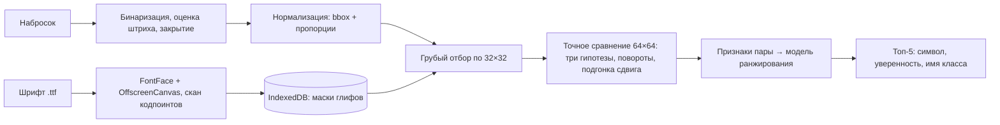

# Saby Icon Search — расширение Chrome

Нарисуйте иконку в popup — расширение найдёт похожие иконки в вашем шрифте и отдаст имя класса
из `.less` (например, `icon-ClientChat`), готовое к вставке в разметку.

Полностью на фронтенде: ни бэкенда, ни нейросетей на сервере. Модель ранжирования — крошечная
(около тысячи весов, 10 КБ), обучена заранее и лежит в репозитории.

---

## Как это работает



**0. Набросок.** Альфа-канал холста бинаризуется фиксированным низким порогом: тонкая линия кисти
после уменьшения холста бледнеет до альфы 60–150, и подбор порога по Отсу рвал её на куски.

**1. Представления.** Набросок и каждый глиф превращаются в три фигуры: `fill` (границы силуэта

- IoU), `skeleton` (медиальные оси штрихов) и `contour` (линии наброска против контура глифа).
  Расстояние — симметричный Чампфер с экспоненциальным усреднением, чтобы далёкие точки весили
  больше; для каждой точки учитывается ещё и направление ближайшей линии.

**2. Кадры и повороты.** Два кадра нормализации: `fitted` (пропорции сохранены) и `stretched`
(bbox растянут). Пять поворотов наброска (−10°…+10°).

**3. Двухступенчатый отбор.** Грубый проход по 32×32 оставляет 300 кандидатов, точное сравнение
в 64×64 считается только для них. Лучшим из них достаётся ещё и **подгонка сдвига и масштаба**:
рамка по bbox хрупкая — недорисованная ножка меняет габариты и сдвигает всю фигуру.

**4. Обученное ранжирование.** Для каждой пары «набросок — глиф» считается вектор из 38 признаков:
расстояния по трём гипотезам в обе стороны, несовпадение направлений линий, IoU, HOG,
топология (дырки и куски), профили проекций, расхождение площадей и длин контуров. Модель
(линейная часть + скрытый слой на 24 нейрона) выдаёт логит; к нему добавляется ручная формула
(два разных оценщика устойчивее одного), а итоговая «уверенность» — softmax по пулу кандидатов,
то есть оценка вероятности, что это именно та иконка. Если модели нет или
набор признаков не совпал, работает прежняя ручная формула (см. `src/core/matching/matcher.ts`).

- **Уверенность — это вероятность в пуле, а не процент сходства**: если рядом лежат две
  почти одинаковые иконки, верная получит, скажем, 45%, а не 99%.
- **Индексация**: `FontFace` декодирует шрифт сам (ttf/woff/woff2 — силами Chrome), кодпоинты
  проверяются через `document.fonts.check`, каждый глиф нормализуется к 64×64 и кладётся в
  IndexedDB бинарной маской (4 КБ на глиф).

### Качество поиска

Настоящих «рукописных» наборов у проекта нет, поэтому качество меряется двумя способами.

**Синтетика.** Стенд берёт случайные иконки из вшитого набора и «рисует» их неточной рукой —
поворот, перекос, дрожание линии, недорисованные детали — в шести манерах (как есть, силуэт,
контур, палочный, небрежный, упрощённый). Рисунок рендерится так же, как на холсте popup:
кисть 4–20 px, сглаженные края, уменьшение до 128×128. Верным считается глиф с той же
картинкой, что у исходной иконки.

| Версия поиска                              |  top-1 |  top-5 |   MRR |
| ------------------------------------------ | -----: | -----: | ----: |
| 1.0.0 (ручные веса)                        | 47,7 % | 62,7 % | 0,549 |
| 2.0.0 (подгонка, признаки, модель + смесь) | 68,8 % | 79,3 % | 0,739 |

Цифры — одни и те же наброски (`seed=23`, 6 манер × 150 штук, сила искажений случайна в
диапазоне 0.4–1.6), модель обучена на других (`seed=303` и другие).

**Живые наброски.** В `tests/sketches` лежат 20 PNG с настоящего холста popup — конверт, домик,
лупа, шестерёнка и так далее, нарисованные ломаными с лёгким дрожанием. Поиск считается
удачным, если среди пяти лучших есть подходящее по смыслу имя (`npm run real-check`):

| Версия поиска | top-1 | top-5 |   MRR |
| ------------- | ----: | ----: | ----: |
| 1.0.0         | 15/20 | 17/20 | 0,792 |
| 2.0.0         | 14/20 | 17/20 | 0,776 |

Здесь разницы нет (в пределах шума на двадцати рисунках): простые понятия старый алгоритм
находил и так, а оставшиеся промахи — вопрос смысла («глаз», «замок»), а не формы. Выигрыш
2.0.0 — в неряшливых, неполных и упрощённых рисунках, как показывает синтетика. Самая
надёжная проверка — собрать несколько десятков настоящих рисунков своей рукой и добавить их
в `tests/sketches`.

## Архитектура

| Контекст            | Роль                                                       |
| ------------------- | ---------------------------------------------------------- |
| `popup.html`        | Только UI. Может закрываться в любой момент.               |
| `service-worker.js` | Создаёт offscreen-документ и следит, чтобы он существовал. |
| `offscreen.html`    | Движок: растеризация, индексация, сопоставление.           |
| `update.html`       | Страница обновления: проверка релиза, скачивание, запись.  |

Popup уничтожается при потере фокуса, поэтому индексация идёт в offscreen-документе — обычной
DOM-странице, где доступны `FontFace`, `OffscreenCanvas` и IndexedDB. Сообщения ходят через
`chrome.runtime.sendMessage` (JSON), бинарные данные — в base64; сами шрифты передаются не
сообщением, а через общий IndexedDB по `fontId`. Набросок восстанавливается при следующем
открытии popup.

## Сборка и установка

```bash
npm install
npm run build      # typecheck + vite build → dist/ + архив релиза
```

Дальше: `chrome://extensions` → включить **Режим разработчика** → **Загрузить распакованное
расширение** → выбрать папку `dist/saby-icon-search-extension`.

| Что в `dist/`                    | Зачем                                                      |
| -------------------------------- | ---------------------------------------------------------- |
| `saby-icon-search-extension/`    | расширение для загрузки распакованным                      |
| `saby-icon-search-extension.zip` | архив для релиза на GitHub (внутри — содержимое без папки) |

Для разработки удобно `npm run watch` — Vite пересобирает, в `chrome://extensions` жмём «Обновить».

### Обновление из релизов GitHub

При открытии popup расширение раз в шесть часов спрашивает GitHub о последнем релизе
(`api.github.com`, без токена и без отправки каких-либо данных). Если вышла версия новее,
в футере появляется кнопка **«Обновить · X.Y.Z»**. Она открывает страницу обновления во
вкладке (диалоги выбора папки закрыли бы popup):

1. страница показывает заметки релиза и просит один раз выбрать **папку, из которой расширение
   загружено в Chrome** (File System Access API; доступ запоминается);
2. проверяет, что в папке лежит `manifest.json` этого же расширения и этой же версии;
3. скачивает `saby-icon-search-extension.zip` из релиза, сверяет SHA-256 (если GitHub её отдал),
   отвергает пути вида `../`, распаковывает и записывает файлы — `manifest.json` последним, чтобы
   оборванное обновление можно было повторить;
4. вызывает `chrome.runtime.reload()`.

Скачивание идёт с `*.githubusercontent.com`, поэтому страница один раз просит разрешение на доступ
к GitHub (кнопка «Разрешить доступ к GitHub»). Если расширение установлено из магазина
(`update_url` в манифесте), страница ничего не трогает — такие обновляет сам браузер.

### Выпуск релиза

1. Поднять `version` в `package.json` (в манифест она попадёт при сборке).
2. Дописать изменения в `CHANGELOG.md`.
3. `git tag vX.Y.Z && git push origin vX.Y.Z` — workflow `Release` соберёт расширение, проверит,
   что тег совпадает с версией, и приложит архив к релизу. Имя файла в релизе менять нельзя:
   по нему расширение находит, что скачивать.

### Отладочный стенд

```bash
npm run dev
```

Открывается `http://localhost:5173/` — тот же `App` во фрейме 400×580, но движок работает прямо
в странице (без offscreen-документа и service worker), есть HMR. Корневой `index.html` в сборку
не попадает.

### Команды

| Команда                | Что делает                                                        |
| ---------------------- | ----------------------------------------------------------------- |
| `npm run build`        | Проверка типов + сборка в `dist/` и архив релиза                  |
| `npm run watch`        | Пересборка при изменениях (архив тоже пересобирается)             |
| `npm run typecheck`    | Только проверка типов                                             |
| `npm test`             | Тесты ядра, обновления и упаковщика архива (Vitest, без браузера) |
| `npm run format`       | Prettier по всему проекту (`format:check` — только проверка)      |
| `npm run check`        | Типы + форматирование + тесты: то же, что гоняет CI               |
| `npm run eval`         | Оценочный стенд поиска на синтетических набросках (см. ниже)      |
| `npm run train-ranker` | Обучение модели ранжирования на данных, собранных стендом         |

### Оценочный стенд и обучение модели

```bash
npm run eval -- --n=150 --seed=23 --level=mixed --jobs=16     # замер качества
npm run eval -- --jobs=16 --set=softness=3,coarseKeep=200      # подмена параметров
npm run eval -- --verbose --dump=fails.png                     # промахи глазами
```

Стенд растеризует вшитый шрифт через `@napi-rs/canvas` теми же параметрами, что расширение,
синтезирует наброски и гонит их через тот же `prepareSketch` и `searchGlyphs`, что и реальный
поиск. `--jobs=N` разбивает работу на процессы (на 16 ядрах замер занимает около минуты).

Переобучение модели (нужно, если менялись признаки, размер пула или алгоритм):

```bash
npm run eval -- --n=2000 --seed=303 --level=mixed --jobs=20 --collect=/tmp/train/d
npm run train-ranker -- --data=/tmp/train/d --out=src/core/matching/rankModel.json --hidden=24 --stride=2
npm run eval -- --n=150 --seed=23 --level=mixed --jobs=16     # проверка на других данных
npm run real-check                                            # и на живых набросках
```

Обучать и проверять нужно на разных `--seed`: иначе цифры будут завышены. На входе обучения
добавляется шум, а температура softmax подбирается по отложенной части, чтобы модель не
выдавала уверенных ответов на непривычных рисунках. Модель обучена на синтетике, поэтому
после каждого переобучения смотрите и `real-check`: рост на синтетике сам по себе ничего
не гарантирует. В `params.blend` модель смешивается с прежней ручной формулой — два разных
оценщика устойчивее одного.

Тест `вшитая модель обучена на том же наборе признаков` упадёт, если список признаков в коде
изменился, а модель осталась старой. `npm run try-sketch -- рисунок.png` прогоняет один PNG
и печатает топ по модели и по ручной формуле: удобно разбирать «живой» набросок, на котором
поиск ошибся.

## Встроенные файлы

В поставку вшиты шрифт и стили, поэтому расширение работает сразу после установки:

| Файл                             | Что это                               |
| -------------------------------- | ------------------------------------- |
| `public/defaults/cbuc-icons.ttf` | шрифт иконок                          |
| `public/defaults/_glyphs.less`   | стили с именами классов и кодпоинтами |

- Ставятся автоматически при первом запуске; удалить их нельзя (бейдж «встроенный»), только
  обновить — перечитать файл из поставки.
- Свои шрифты и стили **дополняют** вшитые. При конфликте кодпоинтов выигрывает добавленный
  позже, то есть свой. Повторно добавленный файл заменяет свою версию, а не дублируется.
- `.less` и шрифт должны быть из одной версии набора: во вшитых 315 имён объявлены, но глифа
  в шрифте нет — они не найдутся никогда. В настройках это видно предупреждением со списком.
- Диагностика — `chrome://extensions` → **Проверить представления** → `offscreen.html` → консоль.

## Настройки

Вход — шестерёнка внизу справа. Источники: **стили (.less)** и **шрифт (.woff/.woff2/.ttf/.eot)** —
файлом или по ссылке. Прогресс показывает этапы: загрузка → разбор глифов → сохранение.

- Доступ к сайтам проверяется сразу при открытии popup: запрос разрешения уводит фокус и
  закрывает popup, поэтому незавершённое добавление сохраняется и продолжается при следующем
  открытии.
- Тема и язык — в футере панели, настройки запоминаются.

## Результаты и редактор

- Показываются **топ-5**: настоящий символ шрифта, уверенность и имя класса из `.less`.
- Клик по ячейке — панель деталей с копированием имени класса; под отладкой видны все метрики.
- Инструменты: кисть и заливка, ползунок толщины. Заливка закрашивает только область под щелчком.
- История — 24 шага (штрих, заливка, стирание), «Очистить» тоже можно отменить.
- В футере — счётчик «Иконок: N» (сколько глифов из `.less` нашлось в шрифте), кнопка
  обновления (когда вышла новая версия) и вход в настройки.

## Иконка расширения

| Файл                           | Что это                       |
| ------------------------------ | ----------------------------- |
| `public/icons/icon-16.png`     | 16 px — тулбар                |
| `public/icons/icon-32.png`     | 32 px — тулбар на HiDPI       |
| `public/icons/icon-48.png`     | 48 px — страница расширений   |
| `public/icons/icon-128.png`    | 128 px — карточка в сторе     |
| `public/icons/icon-dark-*.png` | те же размеры для тёмной темы |

Chrome не выбирает иконку тулбара по теме, поэтому тёмный набор ставится в рантайме через
`chrome.action.setIcon`: тему читает offscreen-документ и сообщает service worker'у.

Исходники — в `design/icons/`: `v22.svg` (светлый), `v23.svg` (тёмный), `v22-16.svg` и
`v23-16.svg` (вариант для 16 px — поля ужаты, «93%» крупнее), `ref.png` (образец),
`preview.html` (превью).

## Структура проекта

```text
src/
├─ shared/          константы, типы, протокол, транспорт, хранилище, проверка релизов, чтение zip
├─ core/
│  ├─ image/        бинаризация, морфология, distance transform, скелет, ориентации, нормализация
│  ├─ features/     HOG
│  ├─ matching/     представления фигуры, поиск, признаки, модель ранжирования (rankModel.json)
│  ├─ fonts/        FontFace, скан глифов, растеризация
│  ├─ less/         разбор .less в карту «кодпоинт → класс»
│  └─ store/        IndexedDB
├─ offscreen/       движок и диспетчер запросов
├─ background/      service worker
├─ update/          страница обновления: установщик поверх распакованного расширения
├─ dev/             отладочный стенд (локальный транспорт)
└─ popup/           React + HeroUI UI
scripts/            упаковщик zip, оценочный стенд, обучение ранжирования
tests/              Vitest
.github/workflows/  CI и выпуск релиза по тегу
```

## Ограничения

- **Без `.less` поиск шумит** — ищутся все глифы шрифта, в топ лезут математические знаки и рамки.
- **Поворот — только ±10°**: сильно наклонённый набросок найдёт меньше совпадений.
- **Модель обучена на синтетике и на вшитом наборе** — на чужих шрифтах с другой стилистикой
  она работает, но не оптимизирована под них; при смене набора иконок стоит переобучить.
- **Обновление по кнопке работает только для распакованного расширения** и только в браузерах
  с File System Access API (Chrome, Edge). Для установки из магазина обновляет сам браузер.
- **Потолок индекса** — комфортно до ~5000 глифов; дальше нужна ANN-структура.
- **Память** — разобранные глифы кешируются (около 100 КБ на глиф; 5000 ≈ 500 МБ).
- **Бандл** — `@heroui/react` тянет все компоненты (~830 КБ); можно перейти на поштучные пакеты.
